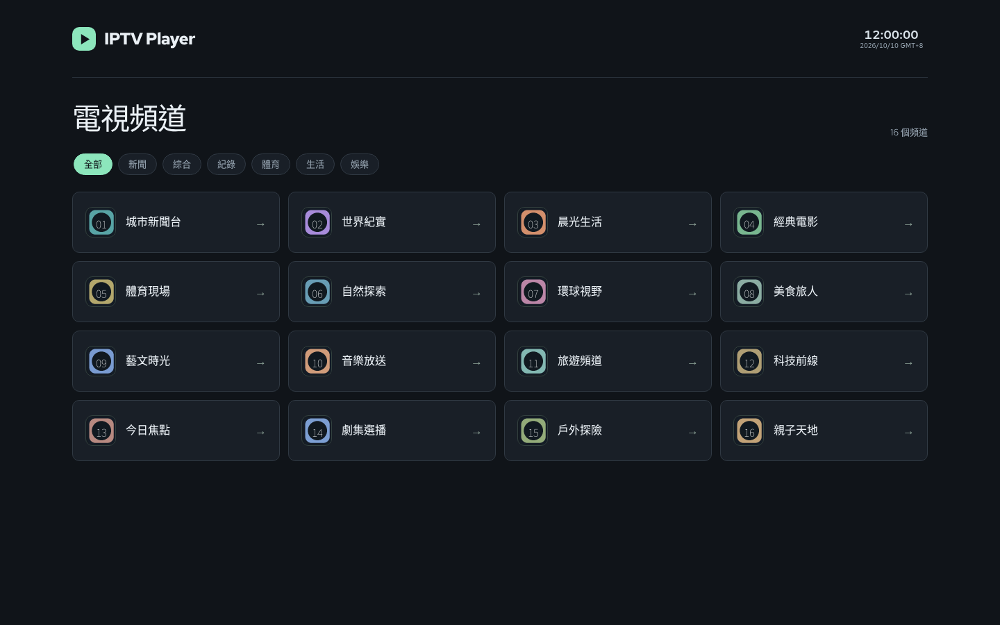
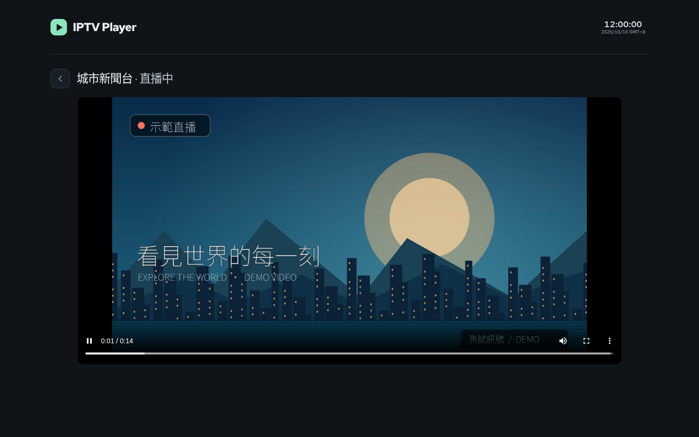

# udisplayer

**把 IPTV 直播變成任何裝置都能打開的網頁播放器。**

udisplayer 是一個自架的 IPTV Web 播放器。它從 **udpxy 或其他 HTTP／HTTPS 電視頻道來源**讀取直播，由伺服器上的 FFmpeg 轉成 HLS，再提供內建的 **IPTV Player** 網頁。電腦、手機和平板只需要瀏覽器，不必自行安裝播放器，也不需要直接連線到 udpxy。

專案以**網路不穩時盡量持續播放**為優先：不追求極低延遲或原始 4K 畫質，而是用較低的輸出碼率和播放緩衝減少卡頓。

## 介面預覽

**頻道列表**：展示電視頻道、分類篩選及各頻道 Logo。



**直播播放**：內建播放器、頻道名稱、播放狀態與瀏覽器原生播放控制列。



> 以上圖片來自實際的 udisplayer 網頁介面，使用自行建立的示範頻道、Logo 與合成測試訊號拍攝；**不包含真實電視頻道、受版權保護的節目或私人 IPTV 來源**。

## 可以做什麼？

- **跨裝置觀看**：支援主流桌面與行動瀏覽器，介面會隨螢幕尺寸調整。
- **集中管理頻道**：可設定頻道名稱、分組與 Logo，也可匯入 Extended M3U 清單。
- **分享同一條串流**：多人觀看同一頻道時，伺服器只需執行一個 FFmpeg 轉流程序。
- **節省頻寬**：超過 1080p 的影像自動縮小；視訊統一輸出 H.264，音訊為 AAC。
- **硬體加速優先、自動回退**：Linux 優先使用 VA-API 硬體解碼、GPU 去交錯／縮放及 H.264 硬體編碼；GPU 濾鏡失敗時先保留可用的硬體編解碼並改用 CPU 濾鏡，硬體編碼或解碼無法使用時才分別回退軟體。完全沒有可用 GPU 時仍可使用 CPU 轉碼。
- **支援 AVS 系列節目**：搭配具備對應解碼器的 FFmpeg，可收看 AVS、AVS+ 及 AVS2（含 Main10／4K）編碼的節目。**目前 AVS 系列視訊全部依靠 CPU 軟體解碼，不支援 AVS 硬體解碼**，對主機效能有一定要求，尤其 AVS2 4K／50fps 可能無法即時轉碼；後續 H.264 輸出仍可使用 VA-API 硬體編碼減輕負擔。
- **自動回收資源**：沒有觀眾的頻道會停止轉流，避免長時間佔用 CPU。
- **自訂存取路徑**：可以設定 URL 前綴，並接在 Nginx 等反向代理後方使用。

> **先確認來源：** udisplayer 不是 IPTV 頻道提供商，也不會附帶任何電視頻道。你需要自己的、可合法使用的 HTTP／HTTPS 直播來源，例如 `http://udpxy.example.test:4022/udp/239.1.1.1:1234` 形式的 udpxy URL。**不能把 `udp://`、`rtp://` 或原始組播位址直接填進頻道配置。** 請先確保**執行 udisplayer 的電腦**可以連到來源，而不只是觀看者的手機可以連到。

## 1. 選擇安裝方式

| 系統／架構 | 建議方式 | 需要準備 |
| --- | --- | --- |
| Linux **x86_64**（AMD64） | GitHub Releases 單檔版（如有提供） | FFmpeg |
| Linux **x86_64／ARM64** 等 | 從原始碼執行 | Python、FFmpeg |
| macOS **Apple Silicon／Intel** | 從原始碼執行 | Homebrew、Python、FFmpeg |

**Linux 單檔版不包含 FFmpeg**，但已包含 Python 執行環境和前端檔案。macOS 目前沒有預先建置的發行版，請依下方 macOS 指引從原始碼啟動。

> **AVS+／AVS2 軟體解碼：** 本專案提供對應的 FFmpeg／libdavs2 差異 Patch、固定版本建置腳本和使用指南，支援以 CPU 解碼 AVS、AVS+ AWQ 以及 AVS2 Main10，再輸出 H.264/AAC HLS。AVS 系列解碼目前依賴 CPU，即使啟用 VA-API 也不代表 AVS 硬體解碼；4K50 對主機效能要求高。詳見 [AVS 播放指南](docs/avs.md)、[Linux 解碼器建置指南](tools/avs/docs/BUILD-LINUX.md) 與 [第三方授權聲明](THIRD_PARTY_NOTICES.md)。不隨播放器打包 FFmpeg 二進位檔。

從原始碼執行時，建議使用 **Python 3.12**（目前專案的測試環境）。服務核心不需要另外 `pip install` 套件；前端會在首次部署時下載固定版本的 hls.js 並製成 `index.html`。需要下載資料，**啟動後播放則不依賴第三方前端 CDN**。

### A. Linux x86_64：使用單檔版

如果專案的 GitHub **Releases** 頁面提供 `udisplayer-linux-x86_64`，下載到預備部署的資料夾，然後執行：

```bash
chmod +x udisplayer-linux-x86_64
./udisplayer-linux-x86_64 --init-channel-list
```

這會在執行檔旁建立 `channels.json`，**不會覆寫既有設定**。接著按照[第 3 節](#3-設定電視頻道)填入你的頻道來源。

安裝完 FFmpeg、設定好頻道後啟動：

```bash
./udisplayer-linux-x86_64 --host 0.0.0.0 --port 8081
```

在同一台電腦打開 `http://127.0.0.1:8081/`；同一區域網路的其他裝置則使用 `http://伺服器IP:8081/`。

> 如果沒有可下載的單檔版，或是 ARM64 Linux，請使用下一節的原始碼方式。單檔版適用於 Linux x86_64；不同發行版的 glibc 相容性仍須以發行包的建置環境為準。

### B. Linux：從原始碼安裝

以下指令以一般終端機操作為例。請依發行版先安裝 Git、Python 與**支援 `libx264` 編碼**的 FFmpeg。

**Ubuntu／Debian**

```bash
sudo apt update
sudo apt install -y git python3 ffmpeg
```

Ubuntu 22.04、Debian 12 等系統預設的 Python 可能不是 3.12。請先執行 `python3 --version`；若不是 3.12，建議額外安裝 Python 3.12 並以 `python3.12` 執行以下步驟，**不要為此替換系統預設的 `python3`**。

**Fedora**

Fedora 的 `ffmpeg-free` 可能缺少本專案需要的 `libx264`。如有需要，先依 [RPM Fusion 官方安裝說明](https://rpmfusion.org/Configuration) 啟用對應版本的 Free 軟體庫，再安裝完整 FFmpeg：

```bash
sudo dnf install -y git python3 ffmpeg
```

若套件與既有的 `ffmpeg-free` 衝突，請依 DNF 顯示的替換清單處理，避免不經檢查就移除其他套件。

**Rocky Linux／AlmaLinux／RHEL**

這類系統通常需要 EPEL、CRB／CodeReady Builder 及相容版本的 RPM Fusion 才能取得完整 FFmpeg。請依自己的作業系統與主版本設定軟體庫（參考 [RPM Fusion](https://rpmfusion.org/Configuration)），再安裝：

```bash
sudo dnf install -y git ffmpeg
```

Python 3.12 的套件名稱與提供情況依發行版版本而異；請另外確認 `python3.12 --version`，不要假設 `/usr/bin/python3` 已符合版本要求。

**Arch Linux／Manjaro**

```bash
sudo pacman -Syu --needed git python ffmpeg
```

**openSUSE Tumbleweed／Leap**

```bash
sudo zypper install git python312 ffmpeg
```

部分 openSUSE 系統的 FFmpeg 套件不含 `libx264`；請確認編碼器是否可用，必要時依對應發行版版本啟用相容的多媒體套件來源（例如 Packman），而不是只檢查 FFmpeg 是否已安裝。

**發行版沒有提供 Python 3.12？** 可以改用 [uv 官方 Python 安裝方式](https://docs.astral.sh/uv/guides/install-python/)，不必覆蓋作業系統的 Python。安裝 [uv](https://docs.astral.sh/uv/getting-started/installation/) 後執行：

```bash
uv python install 3.12
python3.12 --version
```

若找不到 `python3.12` 指令，請先依 uv 的安裝提示把 `~/.local/bin` 加入 `PATH`，或以 `uv python find 3.12` 查詢執行檔完整路徑。之後所有原始碼部署指令都使用 `python3.12`。

安裝完成後檢查：

```bash
python3 --version
ffmpeg -version
ffmpeg -hide_banner -encoders | grep libx264
```

最後一行必須能找到 `libx264`。如果 `python3` 不是 3.12，但 `python3.12` 已安裝，後面的 `python3` 指令請改用 `python3.12`。

取得 GitHub 原始碼：在專案頁面點 **Code → Download ZIP** 並解壓縮，或使用 Git（將 `OWNER` 換成實際的 GitHub 帳號／組織名稱）：

```bash
git clone https://github.com/OWNER/udisplayer.git
cd udisplayer
```

第一次建置網頁並建立設定：

```bash
python3 tools/fetch_vendor.py
python3 tools/build_web.py
python3 server.py --init-channel-list
```

修改 `channels.json` 後，啟動：

```bash
python3 server.py --host 0.0.0.0 --port 8081
```

現在可由瀏覽器開啟 `http://伺服器IP:8081/`。終端機要保持開啟；按 **Ctrl+C** 可停止服務。

### C. macOS：從原始碼安裝

支援 Apple Silicon 與 Intel Mac，使用相同的原始碼流程。

1. 安裝 [Homebrew](https://brew.sh/)（如尚未安裝）。
2. 打開「終端機」，安裝必要程式：

```bash
brew install git python@3.12 ffmpeg
python3.12 --version
ffmpeg -version
ffmpeg -hide_banner -encoders | grep libx264
```

3. 在 GitHub 專案頁下載 ZIP 並解壓縮，進入解壓後的專案資料夾；或使用 Git：

```bash
git clone https://github.com/OWNER/udisplayer.git
cd udisplayer
```

4. 首次生成網頁和範例頻道設定：

```bash
python3.12 tools/fetch_vendor.py
python3.12 tools/build_web.py
python3.12 server.py --init-channel-list
```

5. 編輯 `channels.json`（見下節），再啟動：

```bash
python3.12 server.py --host 0.0.0.0 --port 8081
```

在這台 Mac 的瀏覽器打開 `http://127.0.0.1:8081/`，或在同一 Wi-Fi 的手機打開 `http://Mac的區網IP:8081/`。macOS 防火牆若詢問是否允許 Python 接收連線，請按你的網路用途選擇。

> macOS 不需要 Node.js、npm 或 Xcode 專案才能**執行**本服務。若 Homebrew 安裝或網路下載前端依賴失敗，請先解決該步驟的錯誤，不要略過 `build_web.py`。瀏覽器不要直接用 `file://` 開啟 `index.html`。

## 2. 確認服務能連到來源

udisplayer 是在**伺服器端**拉取電視頻道，不是在瀏覽器端直接拉流。典型連線如下：

```text
IPTV／udpxy（內網）──HTTP──> udisplayer + FFmpeg ──HLS／HTTP──> 瀏覽器
```

例如 udpxy 在 `udpxy.example.test:4022`，請先從**部署 udisplayer 的機器**測試是否能訪問它。若使用 Nginx／CDN 公開播放器，也不代表 udpxy 需要公開到網際網路。

建議先測試一個已知能播放的 HTTP／HTTPS 來源，再加入其他頻道；如果來源本來就斷流，播放器無法自行修復上游訊號。

## 3. 設定電視頻道

預設會讀取 `server.py` 所在目錄（原始碼版）或執行檔旁（Linux 單檔版）的 `channels.json`。如果沒有執行 `--init-channel-list`，也可以自行複製範例：

```bash
cp channels.example.json channels.json
```

用文字編輯器開啟 `channels.json`，例如：

```json
{
  "groups": ["新聞", "娛樂"],
  "channels": [
    {
      "id": 1,
      "name": "新聞示範",
      "group": "新聞",
      "url": "http://udpxy.example.test:4022/udp/239.1.1.1:1234"
    },
    {
      "id": 2,
      "name": "娛樂示範",
      "group": "娛樂",
      "logo": "2.png",
      "url": "https://example.com/live/channel.m3u8"
    }
  ]
}
```

以上網址**只是格式示例，不是可直接觀看的公開頻道**。請換成你自己的有效來源。

| 欄位 | 作用 |
| --- | --- |
| `id` | **必填**。每個頻道不同的正整數（不可重複）。 |
| `name` | **必填**。播放器顯示的頻道名稱。 |
| `url` | **必填**。伺服器可讀取的 HTTP／HTTPS 串流網址。 |
| `group` | 選填。頻道的分類，例如「新聞」。 |
| `logo` | 選填。本地圖片**檔名**，例如 `2.png`。 |
| `decoder_threads` | 選填，1～16。單一頻道的 FFmpeg 輸入解碼執行緒數；可用於 AVS2 4K 測試，預設使用全域設定。 |
| `codec_hint` | 選填，`cavs` 或 `avs2`。對已知 AVS 來源直接使用 CPU 解碼，避免不支援 AVS 的 VA-API 解碼嘗試；仍可使用 VA-API H.264 硬體編碼。 |
| `avs2_skip_nonref` | 選填，`true`／`false`，預設 `false`；只允許 `codec_hint: "avs2"`。啟用客製化 10-bit AVS2 解碼器的實驗性非參考 B-frame 跳幀，需要額外進行畫質／長時穩定性驗證。 |
| `video_scan` | 選填，`auto`（預設）或 `progressive`。只有實際影格已確認逐行掃描時才使用 `progressive`，以略過 `bwdif`；一般頻道保持自動去交錯。 |
| `avs2_gpu_scale` | 選填，`true`／`false`，預設 `false`。僅允許 `codec_hint: "avs2"` 且 `video_scan: "progressive"`，GPU 濾鏡失敗會先回退 CPU 縮放並保留 H.264 硬編。四 vCPU 測試環境效能較差，不建議直接啟用。 |
| `groups` | 選填的頂層欄位。控制分組顯示順序。 |

放置 Logo 的方式：

```text
udisplayer/
├── channels.json
└── logos/
    ├── 1.png
    └── 2.png
```

設定中的 `"logo": "2.png"` 對應到 `logos/2.png`，不填或找不到圖片時會顯示預設圖標。如果使用 `--channel-list /path/to/channels.json`，Logo 必須放在 `/path/to/logos/`。**`--channel-list` 支援絕對及相對路徑；相對路徑一律從 `server.py` 所在目錄（單檔版為執行檔所在目錄）解析，與執行指令時的工作目錄及 INI 所在目錄無關。**

修改頻道名稱、網址、分組或 Logo 後，**重新啟動 udisplayer，並重新整理瀏覽器頁面**，變更才會生效。實際配置與 Logo 預設已被 `.gitignore` 排除，不會隨原始碼提交到 Git。

### 已有 M3U 播放清單？

專案附有轉換工具，可把 **Extended M3U** 的 `#EXTINF`、`group-title`、`tvg-logo` 轉成頻道清單與本地 Logo：

```bash
python3 tools/convert_m3u.py /path/to/playlist.m3u --output channels.json --logos logos
```

macOS 使用 `python3.12` 即可。此工具僅接受 HTTP／HTTPS 頻道網址；不是所有 M3U 格式都能直接匯入。下載個別 Logo 失敗不會刪掉對應頻道。

**注意：轉換時會覆寫指定的 `channels.json`，並重建指定的 `logos/` 目錄。** 匯入前請備份現有設定與圖片；不要對正在使用的正式配置反覆試跑。

## 4. 開啟播放器與常用設定

預設設定：

| 項目 | 預設值 |
| --- | --- |
| 監聽位址 | `0.0.0.0`（所有網路介面） |
| HTTP 連接埠 | `8081` |
| URL 路徑 | `/` |
| 同時轉流的**不同頻道** | 4 |
| 無活動後回收串流 | 60 秒 |

若只打算在本機觀看：

```bash
python3 server.py --host 127.0.0.1
```

如果要讓家中其他裝置連接，可使用預設的 `0.0.0.0`。Linux 或 macOS 防火牆如有啟用，還必須依實際需求允許 TCP 8081；請勿為此直接關閉整個防火牆。

要改連接埠，例如 9090：

```bash
python3 server.py --port 9090
```

要把播放器放在自訂路徑：

```bash
python3 server.py --path /tv/my-long-private-path
```

瀏覽器網址就變成 `http://伺服器IP:8081/tv/my-long-private-path/`。注意末尾的 `/`。以上指令是**原始碼版**；若使用單檔版，請把 `python3 server.py` 替換為 `./udisplayer-linux-x86_64`。

> **安全提醒：** udisplayer 沒有內建帳號登入功能，`--path` 也不是密碼驗證。若要讓公網存取，建議把服務綁在 `127.0.0.1`，由 HTTPS 反向代理提供存取控制；不要僅靠難猜的 URL 保護內容。

### Linux：啟用 VA-API 硬體編解碼（選用）

udisplayer 在 **Linux** 會自動尋找第一個可存取的 `/dev/dri/renderD*`。只要 FFmpeg、VA-API Runtime、顯示卡驅動及裝置權限都正常，就會**優先硬解來源視訊、優先以 GPU 編碼 H.264**。當兩者均可用時，也會優先使用 GPU 去交錯及縮放（`deinterlace_vaapi`、`scale_vaapi`），減少影格在 GPU 和 CPU 間往返。GPU 濾鏡不相容時，會先回退原有 CPU 濾鏡並保留硬體編解碼；硬體解碼或編碼失敗時，再獨立回退軟體。輸出一律為 H.264／AAC。AVS／AVS2 保留軟解與既有 GPU 縮放選用策略。

**自動選擇與回退順序：**

1. **優先使用 GPU**：來源可硬解、H.264 可硬編時，嘗試 `VA-API 解碼 → GPU 去交錯／縮放 → VA-API H.264 編碼`。
2. **GPU 影像濾鏡失敗**：先保持硬體解碼／編碼，改用既有的 CPU `bwdif`／`scale` 濾鏡，不因單一濾鏡不相容就放棄整條硬體管線。
3. **硬體解碼或編碼失敗**：依故障階段獨立回退 CPU 解碼或 `libx264` 軟體編碼，盡量保留仍可使用的硬體階段。
4. **沒有可用 GPU／VA-API 驅動**：直接採用全軟體轉碼，不需要手動改設定；可使用 `--hw-render=none` 主動停用硬體加速。

回退僅作用於出問題的頻道，並保留該頻道的 HLS 播放 URL、串流 Token 與觀眾工作階段；切換時播放器仍可能短暫重新緩衝。**這是盡力回退，不代表所有來源格式都一定能成功解碼**：軟體 FFmpeg 仍需具備來源編碼格式的解碼器。

先安裝所用顯示卡的 VA-API 驅動及測試工具。例如在 **Ubuntu／Debian（Intel GPU）**：

```bash
sudo apt install -y vainfo libva-drm2 intel-media-va-driver
```

**Rocky Linux／RHEL 類系統（Intel GPU）**可先安裝 `libva`、`intel-gmmlib`，再從與發行版相容的套件來源（部分版本需要 RPM Fusion Nonfree）安裝 `intel-media-driver`。AMD 等其他 GPU 需改用對應的 VA-API 驅動，不應直接安裝 Intel 驅動。套件名稱依發行版及 GPU 世代而異。

檢查 GPU 與硬體編碼能力：

```bash
ls -l /dev/dri/renderD*
vainfo --display drm --device /dev/dri/renderD128
ffmpeg -hide_banner -encoders | grep h264_vaapi
```

其中 `vainfo` 應確認所需的解碼 `VAEntrypointVLD` 與 H.264 編碼 `VAEntrypointEncSlice`／`VAEntrypointEncSliceLP`；**FFmpeg 有列出 `h264_vaapi` 並不保證 GPU 真能硬編**，程式啟動時還會執行實際的硬編影格測試。

啟動方式：

```bash
# 自動選擇第一個可用的 GPU（預設）
python3 server.py

# 明確指定 DRM Render Node
python3 server.py --hw-render=/dev/dri/renderD128

# 不使用 GPU，強制 CPU 解碼與編碼
python3 server.py --hw-render=none
```

如果使用單檔版，將 `python3 server.py` 換成 `./udisplayer-linux-x86_64`。多張 GPU 時，也可指定 `/dev/dri/by-path/` 下實際存在的 `pci-*-render` 符號連結；**明確指定的裝置若不存在或無權限，程式會記錄警告並回退 CPU 軟體轉碼，不會偷偷切到另一張 GPU**。裝置路徑格式不合法則仍會報錯。

加上 `--debug` 後，可從啟動日誌查看 `device_ok=True`、`h264_encode=True`，播放頻道時則會顯示 `transcoder=vaapi_decode_encode gpu_vpp=True`、`transcoder=vaapi_encode` 等實際管線。`gpu_vpp_fallback` 代表 GPU 濾鏡失敗後已回退 CPU 濾鏡，而非整個硬體編解碼失效。若服務經 systemd 啟動，請另外確認執行帳號可存取 `render` 群組與 Render Node；設有 `PrivateDevices=true` 的系統服務還必須調整裝置隔離設定。

更完整的 [Linux VA-API 安裝、systemd 權限、排錯及回退說明](docs/HARDWARE-ACCELERATION.md) 見技術文件。

### 接到 Nginx 後方（選用）

假設啟動參數是 `--host 127.0.0.1 --port 8081 --path /tv/my-long-private-path`，Nginx 對應的 `server` 裡可加入：

```nginx
location ^~ /tv/my-long-private-path/ {
    proxy_pass http://127.0.0.1:8081;
    proxy_buffering off;
    proxy_cache off;
}
```

**不要**在 `proxy_pass` 的位址最後加 `/`，否則原有前綴可能被去掉。完整前綴中的首頁、頻道資料、Logo 與 HLS 都要轉發；動態的 HTML／JSON／HLS 不應經代理快取，Logo 則可保留程式原有的瀏覽器快取標頭。

## 5. 設為常駐服務（選用）

先確認手動啟動可正常看台，再設定自動啟動。

### Linux：systemd 使用者服務

不必先把整個專案搬到系統目錄。先在 udisplayer 專案資料夾執行 `pwd`，並用 `command -v python3.12` 查看 Python 的完整路徑；若使用單檔版，則找出執行檔的完整路徑。

先執行 `mkdir -p "$HOME/.config/systemd/user"`，再建立 `~/.config/systemd/user/udisplayer.service`：

```ini
[Unit]
Description=udisplayer IPTV Player
After=network-online.target
Wants=network-online.target

[Service]
Type=simple
WorkingDirectory=/home/YOUR_USER/udisplayer
ExecStart=/usr/bin/python3.12 /home/YOUR_USER/udisplayer/server.py --host 0.0.0.0 --port 8081
Restart=on-failure
RestartSec=5

[Install]
WantedBy=default.target
```

把 `YOUR_USER` 和 Python 路徑改成實際值；**systemd 的 `ExecStart` 應使用絕對路徑**。如果使用 Linux 單檔版，`ExecStart` 改為執行檔的完整路徑，例如：

```ini
ExecStart=/home/YOUR_USER/udisplayer/udisplayer-linux-x86_64 --host 0.0.0.0 --port 8081
```

完成後執行：

```bash
systemctl --user daemon-reload
systemctl --user enable --now udisplayer.service
systemctl --user status udisplayer.service
journalctl --user -u udisplayer.service -f
```

使用者登出後也要繼續運作，可由具管理權限的帳號執行 `sudo loginctl enable-linger YOUR_USER`。修改 `channels.json` 後可使用 `systemctl --user restart udisplayer.service` 重啟。此範例使用**使用者層級**的 systemd，不需要以 root 身分執行播放器。

### macOS：登入後自動啟動（launchd）

macOS 可透過 `launchd` 在使用者登入時啟動。在終端機先確認：

```bash
pwd
command -v python3.12
```

再執行 `command -v ffmpeg`，確認 FFmpeg 的完整路徑。先執行 `mkdir -p "$HOME/Library/LaunchAgents"`，再建立 `~/Library/LaunchAgents/com.udisplayer.player.plist`，內容如下（將 `/Users/YOUR_USER/udisplayer`、Python **和 FFmpeg** 路徑改成實際值；Apple Silicon 的 Homebrew 通常在 `/opt/homebrew`，Intel Mac 常見於 `/usr/local`）：

```xml
<?xml version="1.0" encoding="UTF-8"?>
<!DOCTYPE plist PUBLIC "-//Apple//DTD PLIST 1.0//EN" "http://www.apple.com/DTDs/PropertyList-1.0.dtd">
<plist version="1.0">
<dict>
    <key>Label</key>
    <string>com.udisplayer.player</string>
    <key>ProgramArguments</key>
    <array>
        <string>/opt/homebrew/bin/python3.12</string>
        <string>/Users/YOUR_USER/udisplayer/server.py</string>
        <string>--ffmpeg</string>
        <string>/opt/homebrew/bin/ffmpeg</string>
        <string>--host</string>
        <string>0.0.0.0</string>
        <string>--port</string>
        <string>8081</string>
    </array>
    <key>WorkingDirectory</key>
    <string>/Users/YOUR_USER/udisplayer</string>
    <key>RunAtLoad</key>
    <true/>
    <key>KeepAlive</key>
    <true/>
</dict>
</plist>
```

載入：

```bash
launchctl bootstrap "gui/$(id -u)" "$HOME/Library/LaunchAgents/com.udisplayer.player.plist"
launchctl print "gui/$(id -u)/com.udisplayer.player"
```

修改 plist 後，先解除載入再重新載入：

```bash
launchctl bootout "gui/$(id -u)" "$HOME/Library/LaunchAgents/com.udisplayer.player.plist"
launchctl bootstrap "gui/$(id -u)" "$HOME/Library/LaunchAgents/com.udisplayer.player.plist"
```

特別注意：`launchd` 不一定使用終端機的 Homebrew `PATH`，所以這裡必須透過 `--ffmpeg` 指定實際路徑；不要直接照抄 Apple Silicon 的範例到 Intel Mac。這是**使用者登入時**啟動的 LaunchAgent，不等於未登入也能開機運作的系統 LaunchDaemon。若需要真正的無人值守伺服器，請另外依 macOS 權限與服務帳號規劃 LaunchDaemon。

## 6. 常見問題

**網頁打不開**

先確認終端機沒有顯示啟動錯誤、連接埠正確，以及服務是否正在監聽。若在另一台裝置訪問，請使用**伺服器的區網 IP**，不是 `127.0.0.1`；並檢查路由器／防火牆有沒有阻擋 TCP 連接埠。如果設定了 `--path`，網址必須包含完整路徑。

**有頻道列表，但播放時一直「正在加載」或顯示錯誤**

請確認執行 udisplayer 的機器能直接存取來源 URL，並且 FFmpeg 支援來源的視訊／音訊格式。程式目前預期每個頻道都有可用的視訊和音訊串流；僅有視訊、沒有音訊的來源可能無法正常轉流。初次播放需要等待 FFmpeg 產生第一個 HLS 分段。

**啟動時顯示 `找不到 FFmpeg` 或 `FFmpeg 缺少必要能力`**

請先執行：

```bash
ffmpeg -hide_banner -encoders | grep libx264
ffmpeg -hide_banner -encoders | grep aac
```

若系統裝了多個 FFmpeg，可以明確指定正確版本：

```bash
python3 server.py --ffmpeg /完整路徑/ffmpeg
```

例如 macOS 可用 `command -v ffmpeg` 確認位置。指定的 FFmpeg 路徑如果無效，程式**不會**偷偷退回其他版本。

**AVS+／AVS2 頻道無法解碼，或 4K AVS2 CPU 過載**

這和一般 H.264／H.265 頻道的解碼支援不同。要使用含 AWQ 的 AVS+ 或 10-bit 的 AVS2，可能需要獨立建置的客製化 FFmpeg；`udisplayer` 不會自動替你補上。請依 [AVS 節目播放指南](docs/avs.md) 檢查建置、`cavs`／`libdavs2`、實際解碼樣本、CPU 執行緒、實驗性跳幀開關與授權限制，避免直接修改正式系統 FFmpeg。

**提示找不到 `index.html` 或 `vendor/lock.json`**

這通常代表從原始碼執行時漏掉首次建置：

```bash
python3 tools/fetch_vendor.py
python3 tools/build_web.py
```

**觀看幾個不同頻道後 CPU 使用率很高**

每個**正在使用的不同頻道**需要一個 FFmpeg 視訊編碼程序；多人看同一頻道則共用。若伺服器 CPU 較少，可降低 `--max-streams`，例如 `--max-streams 2`。在 Linux 可透過 DRM Render Node 啟用 VA-API 硬體解碼／H.264 硬體編碼（詳見 [硬體加速說明](docs/HARDWARE-ACCELERATION.md)）。沒有可用 GPU 或驅動時仍沿用原有軟體轉碼。

**串流停止後暫存資料會保留嗎？**

HLS 分段存於暫存目錄，正常停止時會清理。預設使用系統暫存目錄，也可用 `--cache-dir /path/to/cache` 指定可寫入位置；Linux 單檔版還需要主機有可寫、允許執行的暫存空間（必要時設定 `TMPDIR`）。

**如何找出問題？**

啟用 `--debug` 後，終端機或服務日誌會出現較詳細的來源、FFmpeg、HLS 與瀏覽器播放資訊：

```bash
python3 server.py --debug
```

正常模式則以播放 session 為單位記錄起播、錯誤與結束，不輸出每個 HTTP 請求的完整紀錄。公開分享日誌前，請留意其中可能包含來源 IP、頻道名稱和串流相關資訊。

## 7. 其他 CLI 選項

執行 `python3 server.py --help`（或單檔版的 `--help`）可查看完整選項：

| 參數 | 預設 | 說明 |
| --- | --- | --- |
| `--config` | 不使用 INI | 選填的伺服器 INI 配置檔；命令列選項優先於 INI。 |
| `--channel-list` | `channels.json` | 頻道列表 JSON 路徑；相對於 `server.py` 所在目錄。 |
| `--host` | `0.0.0.0` | 綁定 IP。 |
| `--port` | `8081` | HTTP TCP 埠。 |
| `--path` | `/` | 網頁及 HLS 的 URL 前綴。 |
| `--ffmpeg` | 從 PATH 搜尋 | FFmpeg 執行檔路徑。 |
| `--hw-render` | 第一個可存取的 DRM Render Node | Linux VA-API GPU；`none` 強制使用軟體編解碼，或指定 `/dev/dri/renderD*`、`/dev/dri/by-path/pci-*-render`。 |
| `--init-config` | — | 建立範例 `udisplayer.ini`；預設位於 `server.py` 旁，可用 `--config` 指定位置，不覆寫。 |
| `--init-channel-list` | — | 建立範例 `channels.json`；位置由 `--channel-list` 或 INI 指定，不覆寫。 |
| `--max-streams` | `4` | 同時轉流的不同頻道上限。 |
| `--encoder-threads` | 自動偵測可用邏輯 CPU 數 | 每個軟體視訊編碼器使用的執行緒數；可指定正整數覆蓋。 |
| `--decoder-threads` | 自動偵測可用邏輯 CPU 數 | 每路來源解碼器的預設執行緒數；可指定正整數或在單一頻道設定覆蓋。 |
| `--startup-timeout` | `30` 秒 | 等待首次可播放串流的時間。 |
| `--idle-timeout` | `60` 秒 | 頻道無活動後自動回收。 |
| `--cache-dir` | 系統暫存目錄 | 放置暫存 HLS 分段。 |
| `--debug` | 關閉 | 輸出詳細播放診斷。 |
| `--version` | — | 顯示版本。 |
| `--licenses` | — | 顯示第三方授權資訊。 |

### INI 伺服器配置（選用）

`udisplayer` 不需要 INI 也可以直接啟動，並繼續沿用 CLI 參數和內建預設值。若希望將 systemd 啟動參數集中管理，可以建立 INI：

```bash
python3 server.py --init-config
python3 server.py --config ./udisplayer.ini
```

`--init-config` 會在 `server.py` 旁建立 `udisplayer.ini`，也可指定 `--config /etc/udisplayer.ini --init-config` 建立在其他位置，**不會覆寫既有檔案**。範例模板參見 [udisplayer.example.ini](udisplayer.example.ini)。systemd 可使用 `ExecStart=/usr/bin/python3.12 /opt/udisplayer/server.py --config /etc/udisplayer.ini`，但不會自動搜尋或載入 INI。

INI 僅支援平面 `key = value`（不支援區段、引號、插值及 include），布林值僅可為 `true`／`false`，未知鍵、重複鍵和無效數值會中止啟動並指出檔案行號。相對 `ffmpeg` 和 `cache-dir` 路徑相對於 **INI 所在目錄**，但相對 `channel-list` **一律相對於 `server.py` 所在目錄**。命令列明確指定的選項會覆蓋 INI，未指定時依 INI 設定或內建預設值（包含 CPU 執行緒自動偵測）。

**升級注意：** 舊版本的 `--config` 曾代表頻道 JSON；現在 `--config` 專指 INI，頻道 JSON 應改用 `--channel-list`。舊版 `--init-config` 用來建立頻道列表，現在應改用 `--init-channel-list`。部署新版時務必檢查 systemd 或其他服務啟動命令，勿直接把 `channels.json` 傳給 `--config`。

## 給開發者

**處理流程：** HTTP／HTTPS IPTV → FFmpeg → 單路 HLS（約 2 秒分段）→ 內建 Web 播放器。1080p 及以下來源原則上保持解析度；更高解析度按顯示比例縮小至 1920×1080 以內。**輸出幀率最高 30fps**；30fps 及以下維持原幀率，50／59.94／60fps 來源分別降至 25／29.97／30fps。降幀發生在解碼後、縮放與編碼前，不代表可省略解碼參考影格。視訊輸出固定 H.264、約 2.2 Mbps VBV；GPU 不可用時使用 x264 `superfast`、CRF 26。音訊為 AAC 80 kbps。播放器容許適度落後直播位置以吸收網路抖動，**並非低延遲直播方案**。

未指定 `--encoder-threads` 與 `--decoder-threads` 時，啟動時會自動採用行程可使用的**邏輯 CPU 數量**（Linux 優先依 CPU affinity 判斷；無法取得時使用 `os.cpu_count()`，最少為 1）。例如可用 4 顆邏輯 CPU 時，兩者預設皆為 4；明確指定的數值仍優先。CLI 的 `--decoder-threads` 是全服務預設；個別頻道可在 `channels.json` 加入 `"decoder_threads": 4`（合法值 1～16）覆蓋全域值。每個不同頻道的 FFmpeg 各自使用執行緒數，且同一個頻道的解碼與軟編可能同時執行，**自動採用 CPU 數量並非保證即時效能**；多頻道或 CPU 繁忙時，可手動降低執行緒數。使用 VA-API 硬體編碼時，`--encoder-threads` 不直接控制硬體編碼器。

**AVS／AVS+／AVS2 支援：** udisplayer **不包含完整 FFmpeg／libdavs2 原始碼或二進位檔**，只呼叫使用者自行安裝的外部 FFmpeg CLI。專案提供自己的 AWQ／AVS2 差異修補、固定上游版本的建置腳本與驗證測試，集中於 **[`tools/avs/`](tools/avs/README.md)**。使用者執行建置腳本時才會從第三方原作者的 Git 倉庫取得其 Patch 與參考資料，並先核對 SHA-256；原始第三方 AVX2 修補不會存放於本專案。詳見 [AVS 外部媒體堆疊](docs/avs.md) 與 [第三方授權聲明](THIRD_PARTY_NOTICES.md)。實驗性 AVS2 跳幀功能預設關閉。

目前不提供多畫質／ABR。HLS 播放器優先使用 hls.js，必要時才使用瀏覽器原生 HLS。轉流在最後一名觀眾離開後可立即釋放，異常斷線則由 idle timeout 保底回收。

原始碼主要結構：

```text
udisplayer/
├── server.py                 # CLI 啟動入口
├── udisplayer/               # HTTP 服務、設定與 FFmpeg 轉流
├── web/                      # 網頁樣板、CSS、JavaScript
├── tools/                    # 前端建置、M3U 轉換、Linux 發行版建置
├── tests/                    # 單元測試
├── channels.example.json     # 頻道配置範例
└── requirements-build.txt    # 建置單檔版的依賴
```

程式測試：

```bash
python3 tools/fetch_vendor.py
python3 tools/build_web.py
python3 -m unittest discover -s tests -v
```

需要建立 **Linux x86_64** 單檔發行版，可在 Linux x86_64 上執行：

```bash
python3 -m venv .venv
.venv/bin/python -m pip install -r requirements-build.txt
.venv/bin/python tools/build_release.py
```

產物為 `dist/udisplayer-linux-x86_64`、`dist/SHA256SUMS` 與 `dist/build-info.json`。此建置腳本目前**不支援 macOS 發行包**，也不會把 FFmpeg 打包進去。

## 授權

專案原始碼使用 [MIT License](LICENSE)。第三方元件與授權聲明請見 [THIRD_PARTY_NOTICES.md](THIRD_PARTY_NOTICES.md) 與 `licenses/`。

請自行確認所使用頻道來源的授權與所在地法規；本專案不提供、轉售或授權任何電視訊號。
